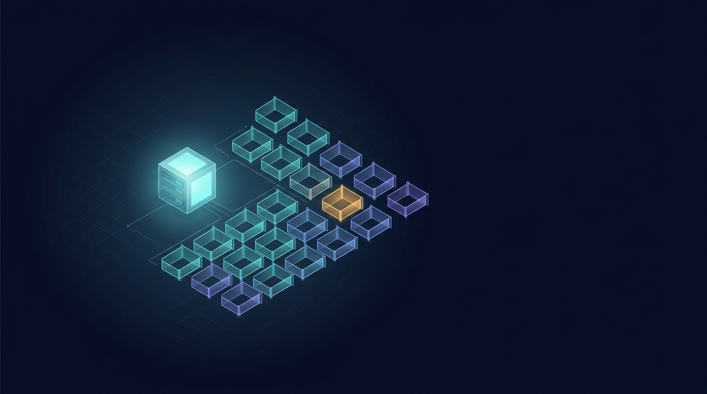
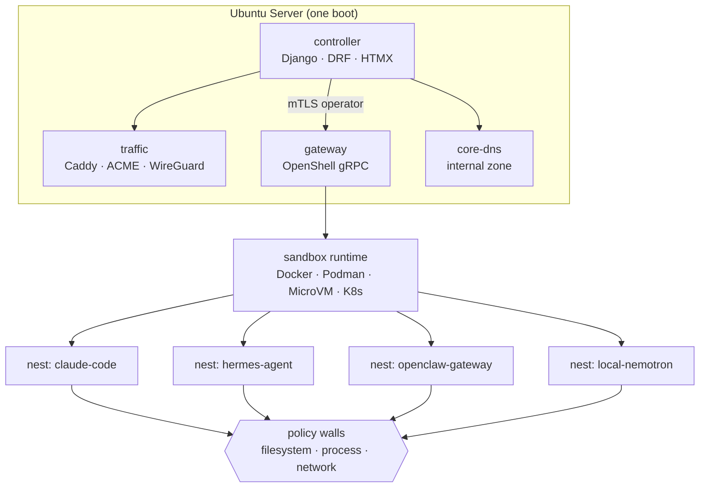

<p align="center">
  <picture>
    <source media="(prefers-color-scheme: dark)" srcset="assets/brand/hero-banner.jpg">
    
  </picture>
</p>

<h1 align="center">Nestbox</h1>

<p align="center"><b>Run OpenShell sandboxes, NemoClaw blueprints and OpenClaw agents from one web UI —
on NVIDIA DGX Spark, on a GPU cloud VM, or on a plain Ubuntu box with cloud models.</b></p>

<p align="center">
  <a href="#quickstart">Quickstart</a> ·
  <a href="#what-it-does">What it does</a> ·
  <a href="#the-ai-firewall">The AI firewall</a> ·
  <a href="#hardware-and-models">Hardware &amp; models</a> ·
  <a href="docs/">Docs</a> ·
  <a href="#api">API</a>
</p>

---

No CLI archaeology. No firewall rules written by hand. Boot the ISO, open the UI, create a sandbox.

Every sandbox gets its own compartment: Landlock filesystem policy, unprivileged process, and
hot-reloadable **AI firewall** rules — created, edited and rolled back in the browser. Sandboxes
appear on demand and disappear again; back up a sandbox or a single file and restore it just as
easily.

> **Independent community project. Not affiliated with or endorsed by NVIDIA.**
> Nestbox works *with* NVIDIA OpenShell, NemoClaw and Nemotron; it is not an NVIDIA product.

## What it does

| | |
|---|---|
| **Nests on demand** | Create a sandbox for Claude Code, Hermes Agent, OpenCode, OpenClaw or a custom stack in one click. Start, stop, exec in, stream logs, delete. |
| **AI firewall** | Declarative filesystem, process and network policy per nest. Edit a rule, it applies to the running sandbox without a restart, and you can roll it back. |
| **Reachability without port forwarding** | Every nest gets a hostname and a valid certificate through the traffic container and the WireGuard overlay. |
| **Backup &amp; restore** | Snapshot the controller, gateway, policies, certificates and every nest workspace. Restore everything or a single file. |
| **Full API** | OpenAPI 3.1, Swagger UI and Redoc on the appliance itself. Tokens, roles, streaming events. |
| **Agent packs** | An agent is 20 lines of YAML. Community packs need no controller release. |

## Quickstart

```bash
git clone https://github.com/matthias1232/nestbox.git
cd nestbox
uv venv && . .venv/bin/activate
uv pip install -e ".[dev]"
cd controlplane
python manage.py migrate
NESTBOX_BOOTSTRAP_ADMIN_EMAIL=you@example.com \
NESTBOX_BOOTSTRAP_ADMIN_PASSWORD='change-me' \
python manage.py bootstrap
python manage.py load_packs
python manage.py runserver
```

Open <http://127.0.0.1:8000/> and sign in. The API lives at `/api/v1/`, Swagger UI at
`/api/docs/`, Redoc at `/api/redoc/`.

Without Docker or an OpenShell gateway the UI still runs: the container map reports
`runtime.unavailable` and nests are recorded as `pending` instead of pretending to be running.

## Architecture



Django is a control plane *on top of* OpenShell, not a reimplementation of it. Isolation,
policy enforcement, credential handling and service exposure stay in the runtime that NVIDIA
maintains. The controller owns desired state, a reconcile loop repairs drift, and the web UI is
the only place a human needs to look.

## The AI firewall

Policies are YAML documents, stored twice on purpose: structured rows drive the form editors, and
the document itself is what the gateway receives. Policies are never rebuilt from rows, so the UI
cannot drift from what is actually enforced.

```yaml
network_policies:
  model-api:
    endpoints:
      - host: api.anthropic.com
        port: 443
        protocol: rest
        enforcement: enforced
        access: allow
    binaries:
      - path: /usr/local/bin/claude
```

Filesystem and process sections are fixed when a nest is created; network sections reload live,
which is why a rule change takes effect without restarting the sandbox. Every change is versioned,
diffable against the effective policy, and rollbackable.

## Hardware and models

Nemotron only — that is the point of the appliance, not a limitation.

| Model | Parameters | VRAM (estimate) | Hardware |
|---|---|---|---|
| Nemotron Nano 12B v2 VL | 12.6B dense | BF16 ~26 GB · FP8 ~14 GB | RTX 4090 / 5090 |
| Nemotron 3 Nano | 30B-A3B | FP8 ~32 GB · NVFP4 ~18 GB | RTX 5090 32 GB, L40S 48 GB |
| Nemotron 3 Super | 120B-A12B | NVFP4 ~65–70 GB | A100 / H100 80 GB, RTX PRO 6000 |
| Nemotron 3 Ultra | 550B-A55B | NVFP4 ~280–300 GB | 4× RTX PRO 6000, DGX B200 |

The VRAM column is our own arithmetic, not vendor guidance; see [docs/hardware](docs/hardware/)
and [docs/claims.md](docs/claims.md) for sources and caveats. No model weights are shipped in the
image — they are pulled on first boot, because the Nemotron licence is not Apache-2.0.

**Four ways to run it, one image:** a GPU cloud VM to try before buying hardware, a local box
without a GPU driven by cloud models, a local box with a GPU for full local inference, or your
laptop hosting the model while the appliance only manages policies. The provider profile is the
only thing that changes.

## API

- `/api/schema/` — OpenAPI 3.1 (JSON, or `?format=yaml`)
- `/api/schema/v1/` — frozen contract, protected in CI
- `/api/docs/` — Swagger UI with *Authorize* and *Try it out*
- `/api/redoc/` — reference documentation
- `/api/v1/` — root discovery document

Every operation carries `x-roles` and `x-effect`; every failure uses one error envelope with a
stable `code`. Clients can be generated from the committed schema, which CI checks.

## Repository layout

```
controlplane/   Django project (config + apps)
packs/          agent packs as YAML
assets/         brand set, prompts, diagram sources
iso/            livefs actions, autoinstall templates, smoke test
firstboot/      first-boot unit and netplan renderer
docs/           English documentation
contracts/      frozen OpenAPI document
```

## Status

This is the Phase 1 foundation: inventory, policy editing, agent packs, API, docs and the
renderer that turns a recipe into cloud-init. The ISO build, the traffic container, the overlay
and restic backups land in the following phases — the data model and interfaces for them are
already in place. See [docs/roadmap.md](docs/roadmap.md) for the phase breakdown.

## Licence

Apache-2.0 with DCO sign-off. See [LICENSE](LICENSE) and [NOTICE](NOTICE).
