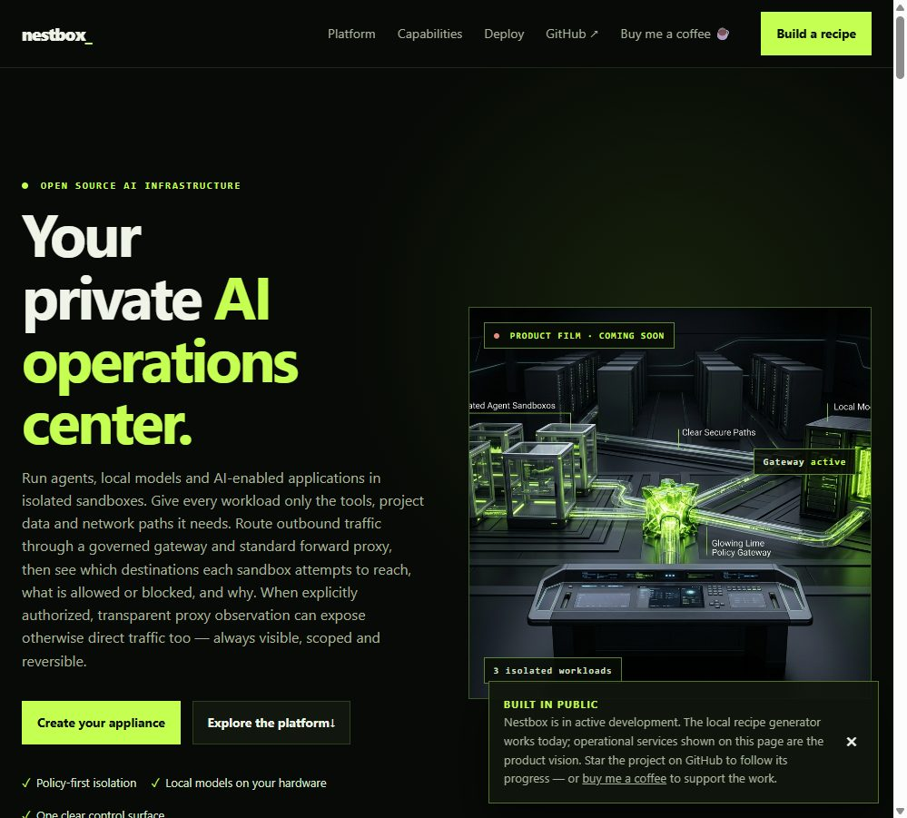
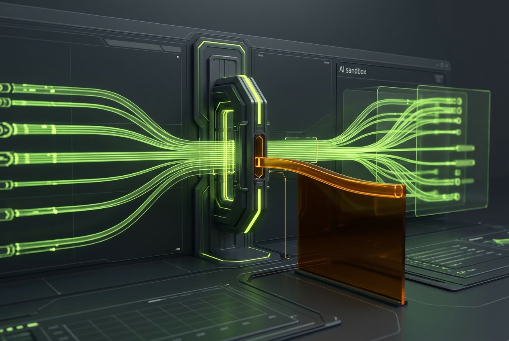
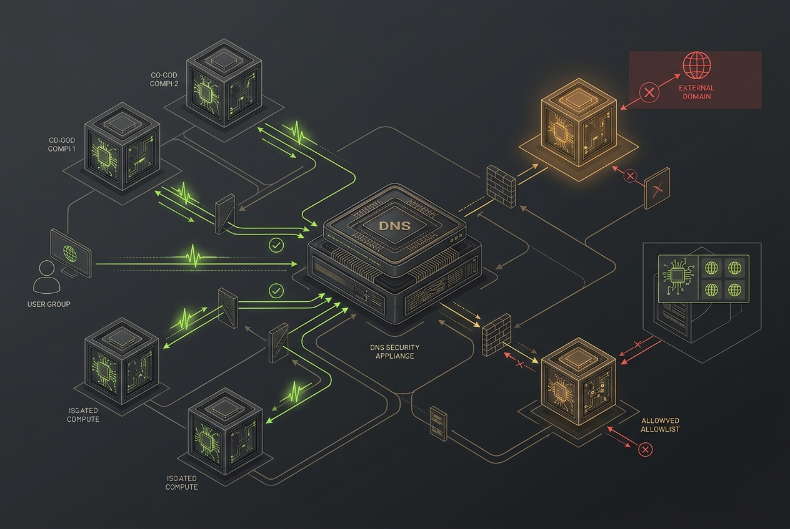
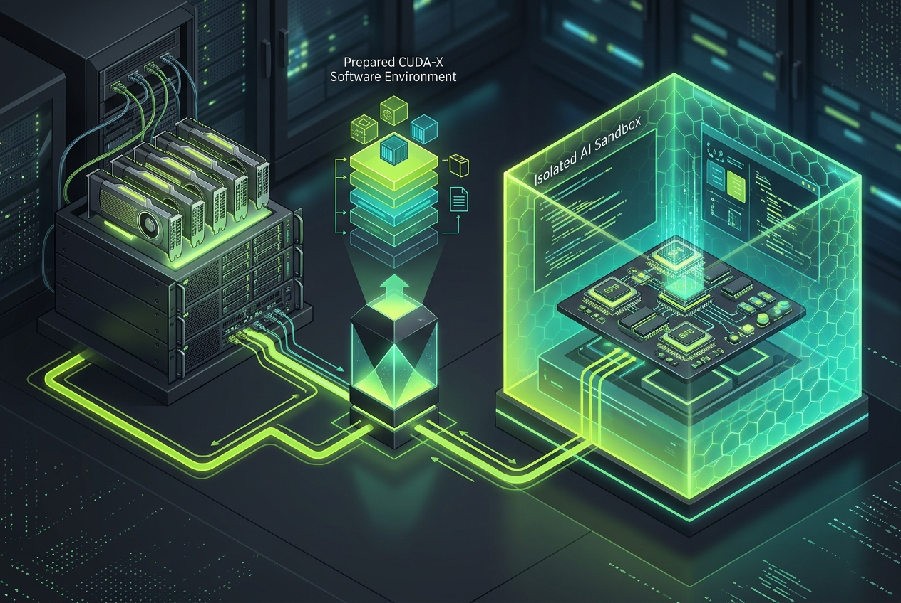

<p align="center">
  <a href="https://nestbox.mmbits.com/"></a>
</p>

<h1 align="center">Nestbox</h1>

<p align="center"><b>Your private AI operations center.</b><br>
Open-source infrastructure for governed AI agents, local models and protected applications.</p>

<p align="center">
  <a href="https://nestbox.mmbits.com/">Website</a> ·
  <a href="https://buymeacoffee.com/matthias1232">Buy me a coffee</a> ·
  <a href="#product-surfaces">Product surfaces</a> ·
  <a href="#architecture">Architecture</a> ·
  <a href="#follow-development">Follow development</a>
</p>

> ## Active development
>
> Nestbox is an early, public-development project. It is **not ready for production or general installation yet**. The pages, visuals and workflows in this repository describe the intended direction while the runtime, control plane and deployment foundations are being built.
>
> Please check back, watch this repository or follow the [Nestbox website](https://nestbox.mmbits.com/) for progress updates and future testing announcements.

> **Support the project.** If the direction is useful to you, star the repository or [buy me a coffee](https://buymeacoffee.com/matthias1232). Your support helps fund time spent on the open-source prototype.

---

## Visit the website

<p align="center">
  <a href="https://nestbox.mmbits.com/"></a>
</p>

<p align="center"><a href="https://nestbox.mmbits.com/"><b>Open the interactive Nestbox product tour →</b></a></p>

## Product vision

Nestbox is intended to become a self-hosted AI operations center. It will make it possible to place an agent, local model or AI-enabled OCI application in its own isolated sandbox; grant only required project data, tools and network paths; and operate the result from one clear control surface.

The project is designed around **OpenShell**, the NVIDIA safe runtime for controlled AI-agent execution. Nestbox adds the surrounding product layer: policy, project mounts, approved tools and MCP capabilities, local model sandboxes, gateway observability, image recipes and deployment history.

> **Independent project.** NVIDIA, OpenShell, NemoClaw, Nemotron, DGX Spark, GB10 Grace Blackwell, NIM and NeMo are NVIDIA product names or trademarks. Nestbox is not affiliated with or endorsed by NVIDIA.

## Product surfaces

| Surface | Intended experience | Status |
| --- | --- | --- |
| Agent sandboxes | Choose OpenShell, NemoClaw, OpenClaw, OpenCode, OpenChamber, Hermes, Claude Code, OpenAI-compatible or custom runtimes. | In development |
| Local model sandboxes | Select validated NVIDIA Nemotron profiles, then manage lifecycle, health and logs. | In development |
| Policy editor | Validate, version, diff, assign, revoke and roll back policy for mounts, tools, DNS, TLS and destinations. | In development |
| Project mounts | Grant read-only or read-write access; detach and reassign without global shared storage. | In development |
| Tools and MCP | Select Git, approved GitHub access, developer tools, CLI packages and MCP capabilities per sandbox. | In development |
| Gateway observability | Live firewall-style console per sandbox: direction, protocol, source, destination, port, decision, status, latency and correlation ID. | In development |
| DNS control | Appliance DNS service, per-sandbox query log, approved resolver policy and hostname/domain blacklist rules. | Planned |
| Rule from event | Select an unusual DNS or network event to draft a sandbox-scoped block rule, then review and apply it. | Planned |
| OCI application sandboxes | Deploy protected images from Docker Hub, private OCI registries and approved image sources. | Planned |
| Image builder | Produce inspectable Ubuntu seed bundles and later ISO artifacts for bare metal, VM, WSL and local GPU targets. | Seed bundle available; larger flow in development |

### Planned compatibility surface

Nestbox is being designed for OpenShell, NemoClaw, OpenClaw, OpenCode, OpenChamber, Claude Code, Codex and ChatGPT workflows, Gemini CLI, Google Antigravity workflows, Hermes, Aider, Cline Agent, Kilo Code, Continue, VS Code workflows, Cursor workflows, OpenAI-compatible endpoints and custom agent runtimes.

These are workflow and compatibility examples. Direct support depends on the sandbox template, agent pack, provider/API configuration and maturity of the relevant integration.

## Visual product tour

<p> </p>

**Local model sandboxes.** Choose a validated NVIDIA Nemotron profile, deploy a dedicated runtime and later start, stop, inspect health and read logs from the Control Center.

**Agent templates and tools.** Choose an agent runtime, approved tools, MCP capabilities, project scope and reusable policy before deployment.

<p> </p>

**Policy and egress.** A governed forward proxy is the intended default. Transparent proxy and TLS inspection are explicit opt-in, sandbox-scoped and disabled by default. A hardened sandbox can start as default-deny and allowlist only required hosts, protocols, ports and tools.

**Deploy where compute lives.** Generate inspectable seed bundles for bare metal, Proxmox, cloud VMs, WSL and local GPU hardware.

## Architecture

```text
React Admin local web console
        ↓ versioned API
FastAPI control API + audit events
        ↓ orchestration
Gateway / policy enforcement / optional egress observation
        ↓ controlled execution
OpenShell runtime
        ↓ isolated workload boundary
Agent sandbox | Model sandbox | Tool-enabled sandbox | OCI app sandbox
```

Each project mount, tool, MCP capability and egress route is an explicit capability grant. The web UI does not receive host privileges, and ordinary sandbox files do not hold long-lived secrets.

## Secure network traffic

The governed forward proxy is the intended default. The planned Admin Center shows a live firewall-style timeline for each sandbox: incoming and outgoing direction, protocol, source, destination, port, policy decision, status, latency and correlation ID.

<p> </p>

**Firewall event to rule.** A suspicious connection can become a sandbox-scoped block-rule draft; an operator reviews the diff and explicitly applies it.

**DNS blacklist and allowlist.** A managed appliance DNS service logs each sandbox query. Block an unwanted name, or use default-deny DNS and allowlist only domains required by a hardened workload.

Transparent proxy observation is planned as explicit opt-in for an authorized sandbox and can be disabled again with its sandbox-scoped trust CA revoked.

## CUDA-X-ready sandbox environments

Many teams already operate NVIDIA GPUs in a private datacenter, lab or cloud environment. Nestbox is planned to make that existing GPU investment easier to use for controlled agent workloads: select a GPU-capable sandbox template and prepare runtime configuration required by an approved CUDA-X software stack.

<p></p>

The planned configuration path can cover CUDA runtime compatibility, GPU device access, container image selection and workload-specific settings for approved components such as CUDA-X libraries, NIM microservices, TensorRT-LLM, RAPIDS or other software already present in the organization.

Nestbox does not replace NVIDIA drivers, CUDA-X software, licensing or vendor support; it is intended to attach approved local or cloud GPU capabilities to a governed sandbox with explicit policy and observability. See [What is NVIDIA CUDA-X?](https://www.nvidia.com/de-de/technologies/cuda-x/).

## Local AI and NVIDIA ecosystem context

Nestbox targets local GPU workstations, DGX Spark-class GB10 Grace Blackwell systems, provider-neutral GPU VMs and NVIDIA cloud resources. NVIDIA Nemotron, NIM, NeMo, NemoClaw, OpenShell and NVIDIA AI Enterprise can be part of a workload stack; Nestbox focuses on the policy-first operations layer around it.

Hardware and model fit depend on quantisation, context length, inference backend and concurrent workloads. A 120B-class model must be validated on the exact target configuration; Nestbox does not make blanket performance claims.

## Future direction: from home lab to teams

Nestbox is being built in the open. The next milestone is repeatable validation: make core workflows reliable, run initial tests, learn from real feedback and announce a wider testing opportunity only when useful evaluation is possible.

If the project proves useful and earns sustained adoption, it could grow from one home-lab host or single VM into a centrally managed fleet: multiple VMs, gateways, sandboxes and local-model runtimes operated from one Control Center. Kubernetes-compatible deployment may be explored when real demand justifies the added complexity.

This is a direction, not a promise or production roadmap. The immediate focus remains a safe, understandable single-host foundation.

## Follow development

The public product tour, active-development notes and working local seed-bundle generator are available at [nestbox.mmbits.com](https://nestbox.mmbits.com/). Watch this repository for releases and architecture updates.

## Project origin and thanks

Nestbox began during the Dev Community Day Berlin hackathon on 25 October 2026. The early project concept, website and presentation were accelerated with OpenAI credits. Thank you to OpenAI for helping make the first public project foundation possible. Additional thanks to NVIDIA and Nous for a 20 US dollar free-credit voucher shared at the RTX Launch Event Berlin, which supported early experimentation and evaluation.

## License

Apache-2.0. See [LICENSE](LICENSE) and [NOTICE](NOTICE).
