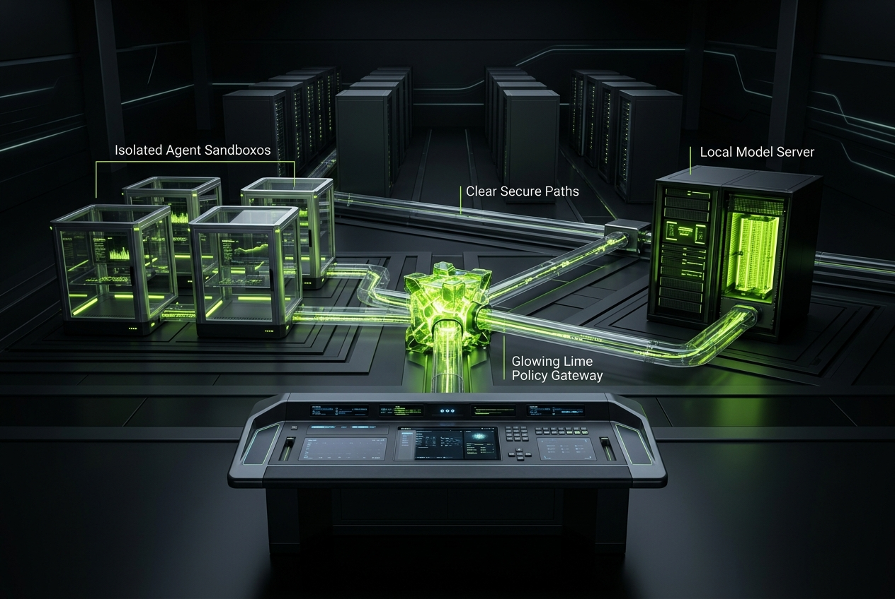
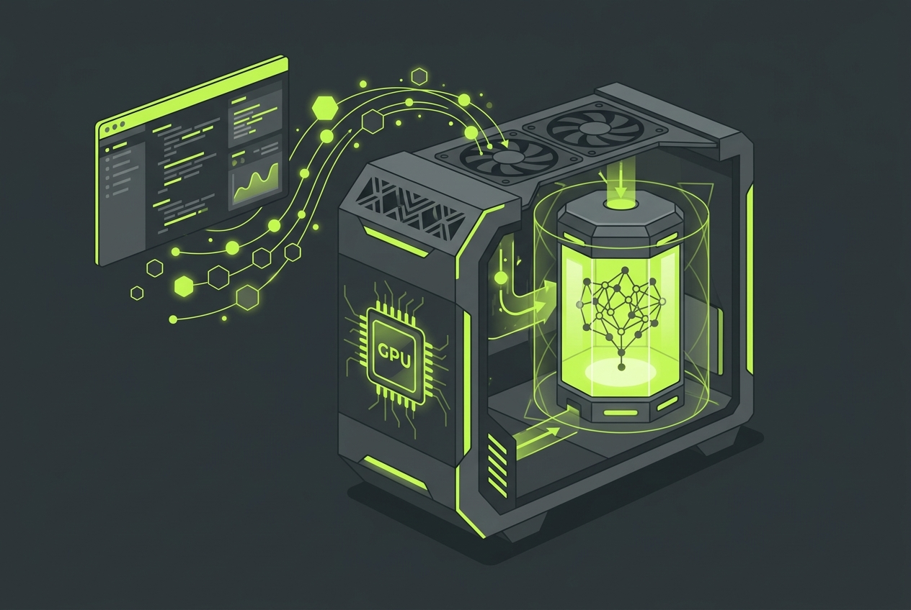
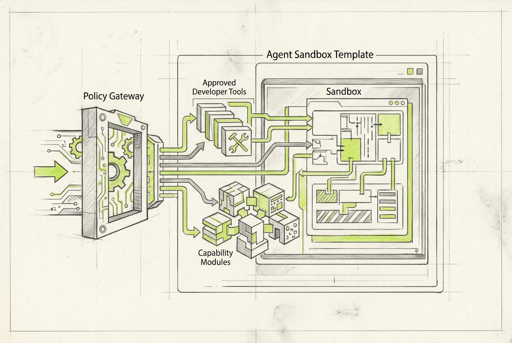
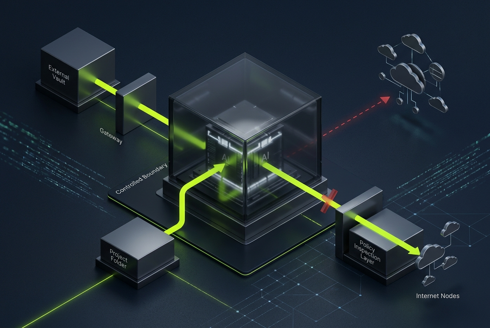
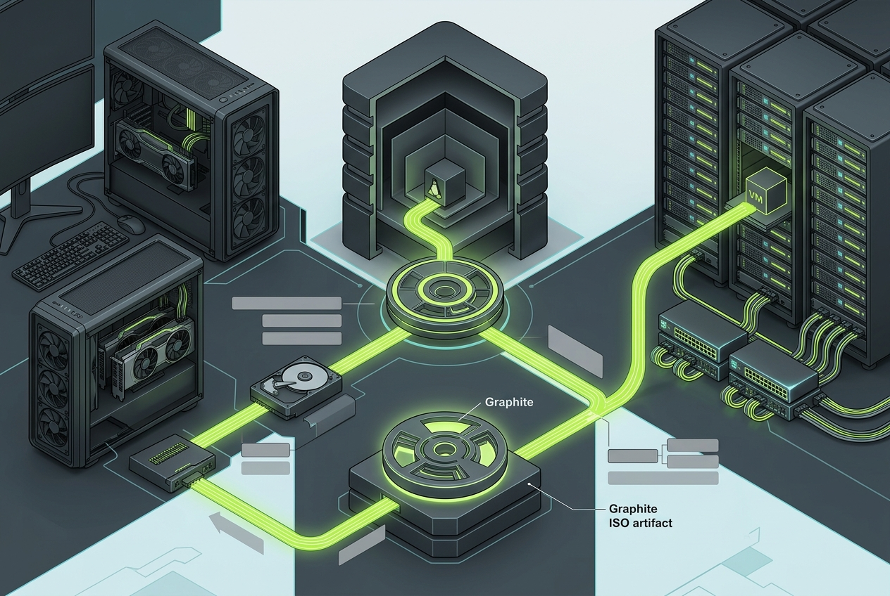

<p align="center">
  
</p>

<h1 align="center">Nestbox</h1>

<p align="center"><b>Your private AI operations center.</b><br>
Open-source infrastructure for governed AI agents, local models and protected applications.</p>

<p align="center">
  <a href="https://nestbox.mmbits.com/">Website</a> ·
  <a href="https://buymeacoffee.com/matthias1232">Buy me a coffee</a> ·
  <a href="#product-vision">Product vision</a> ·
  <a href="#architecture">Architecture</a> ·
  <a href="#follow-development">Follow development</a>
</p>

> ## Active development
>
> Nestbox is an early, public-development project and is **not ready for production or general installation yet**. The pages, visuals and workflows in this repository describe the intended product direction while the runtime, control plane and deployment foundations are being built.
>
> Please check back, watch the repository or follow the [Nestbox website](https://nestbox.mmbits.com/) to track progress as the project evolves.

> **Support the project.** If the direction is useful to you, star the repository or [buy me a coffee](https://buymeacoffee.com/matthias1232). Your support helps fund the time spent on the open-source prototype.

---

## Product vision

Nestbox is intended to become a self-hosted AI operations center. It will make it possible to place an agent, a local model or an AI-enabled OCI application in its own isolated sandbox; grant only the required project data, tools and network paths; and operate the resulting environment from one clear control surface.

The project is designed around **OpenShell**, the NVIDIA safe runtime for controlled AI-agent execution. Nestbox adds the surrounding product layer: policy, mounts, tool and MCP selection, local model sandboxes, gateway observability, image recipes and deployment history.

## Product surfaces
| Surface | Intended experience | Status |
| --- | --- | --- |
| Agent sandboxes | Choose OpenShell, NemoClaw, OpenClaw, OpenCode, OpenChamber, Hermes, Claude Code, OpenAI-compatible or custom runtimes. | In development |
| Local model sandboxes | Select validated NVIDIA Nemotron profiles, then manage lifecycle, health and logs. | In development |
| Policy editor | Validate, version, diff, assign, revoke and roll back policy for mounts, tools, DNS, TLS and destinations. | In development |
| Project mounts | Grant read-only or read-write access; detach and reassign without global shared storage. | In development |
| Tools and MCP | Select Git, approved GitHub access, developer tools, CLI packages and MCP capabilities per sandbox. | In development |
| Gateway observability | Inspect allowed and blocked destinations, route decisions, status and latency per sandbox. | In development |
| OCI application sandboxes | Deploy protected images from Docker Hub, private OCI registries and approved image sources. | Planned |
| Image builder | Produce inspectable Ubuntu seed bundles and later ISO artifacts for bare metal, VM, WSL and local GPU targets. | Seed bundle available; larger flow in development |

## Visual tour
<p> </p>
**Local model sandbox.** Choose a validated NVIDIA Nemotron profile, deploy a dedicated runtime and later start, stop, inspect health and read logs from the Control Center.

**Agent workspace.** Choose an agent runtime, approved tools, MCP capabilities, project scope and reusable policy before deployment.
<p> </p>
**Policy and egress.** A governed forward proxy is the intended default. Transparent proxy and TLS inspection are explicit opt-in, sandbox-scoped and disabled by default.
**Deploy where compute lives.** Generate inspectable seed bundles for bare metal, Proxmox, a cloud VM, WSL and local GPU hardware.

## Architecture
```text
React Admin local web console
        ↓ versioned API
FastAPI control API + audit events
        ↓ orchestration
Gateway / policy enforcement / optional egress observation
        ↓ controlled execution
OpenShell runtime
        ↓ isolated workload boundary
Agent sandbox | Model sandbox | Tool-enabled sandbox | OCI app sandbox
```

Each project mount, tool, MCP capability and egress route is an explicit capability grant. The web UI does not receive host privileges, and ordinary sandbox files do not hold long-lived secrets.

## Secure network traffic
The governed forward proxy is the intended default. Operators can inspect destinations, policy decisions, status and latency without TLS decryption. Transparent proxy observation is planned as explicit opt-in for an authorized sandbox and can be disabled again with its sandbox-scoped trust CA revoked.

## Local AI and NVIDIA ecosystem context
Nestbox targets local GPU workstations, DGX Spark-class GB10 Grace Blackwell systems, provider-neutral GPU VMs and NVIDIA cloud resources. NVIDIA Nemotron, NIM, NeMo, NemoClaw, OpenShell and NVIDIA AI Enterprise can be part of a workload stack; Nestbox focuses on the policy-first operations layer around it.
Hardware and model fit depend on quantisation, context length, inference backend and concurrent workloads. A 120B-class model must be validated on the exact target configuration; Nestbox does not make blanket performance claims.

## Follow development
The public product tour, active-development notes and working local seed-bundle generator are available at [nestbox.mmbits.com](https://nestbox.mmbits.com/). Watch this repository for releases and architecture updates.

## Project origin and thanks
Nestbox began during the Dev Community Day Berlin hackathon. The early project concept, website and presentation were accelerated with OpenAI credits. Thank you to OpenAI for helping make the first public project foundation possible.

## License
Apache-2.0. See [LICENSE](LICENSE) and [NOTICE](NOTICE).
